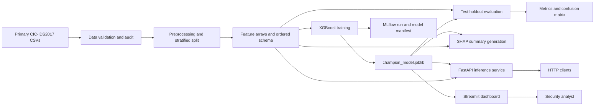

# SENTINEL: Intelligent Network Intrusion Detection and MLOps Monitoring System

## Project Report

**Document purpose.** This report describes the project as it exists in the repository: its problem, dataset, processing and model workflow, architecture, user-facing behavior, evaluation evidence, deployment approach, and known limitations. It distinguishes verified implementation and measured results from intended or future operational behavior.

---

## Abstract

SENTINEL is a local-first network-flow classification and model-operations application. It processes CIC-IDS2017 flow records into a binary benign/malicious target, trains an XGBoost classifier, exposes prediction endpoints through FastAPI, and provides an analyst-facing Streamlit dashboard for single-flow triage, CSV batch analysis, model evaluation, feature-attribution summaries, lineage, and governance information. The project includes DVC pipeline definitions, MLflow tracking in the training code, model and evaluation artifacts, tests, and a Docker deployment configuration.

The checked-in evaluation report identifies the packaged champion as an `XGBClassifier` and reports results on 283,075 held-out test flows: 99.921% accuracy, 99.623% precision, 99.977% recall, 99.875% macro-F1, and 99.997% ROC-AUC. The confusion matrix contains 227,099 true negatives, 211 false positives, 13 false negatives, and 55,752 true positives. A runtime investigation found that this model expects raw, median-imputed feature values and that applying the serialized scaler changes model behavior substantially. The serving path and evaluation procedure were therefore aligned to the model's actual feature contract.

These scores describe performance on the available benchmark split; they do not establish production detection performance on future networks. The current pipeline also computes numeric medians before the train/validation/test split, which can leak information across the split. Dashboard monitoring content is partly illustrative rather than live telemetry. These limitations are important when interpreting the results or presenting the system as production-ready.

**Keywords:** network intrusion detection, CIC-IDS2017, XGBoost, FastAPI, Streamlit, MLOps, model explainability, DVC, MLflow

---

## 1. Introduction

Network operators need ways to review large volumes of connection and packet-flow summaries and prioritize activity that may represent an attack. SENTINEL demonstrates one machine-learning workflow for this task: transform labeled flow records into numeric features, train a binary classifier, produce per-flow predictions and probabilities, and make evaluation and provenance evidence available through an API and dashboard.

The application is designed as analyst decision support. A model output is a prioritization signal, not proof that a flow is malicious. In keeping with that scope, the project model card excludes autonomous packet blocking and calls for human review before mitigation.

### 1.1 Problem statement

Given a network flow represented by numeric traffic attributes, classify it as:

| Encoded value | Meaning |
|---:|---|
| 0 | BENIGN |
| 1 | MALICIOUS (any non-BENIGN label in the selected dataset) |

The system must preserve the same feature ordering between dataset preparation, model training, and inference; make single and batch predictions accessible; and provide evaluation and explanation artifacts that help users understand model behavior.

### 1.2 Project objectives

The repository aims to:

1. Audit the selected CIC-IDS2017 CSV inputs and record data-quality evidence.
2. Derive a numeric feature matrix and persist train, validation, and test splits.
3. Train and evaluate a binary classifier and retain the resulting model artifact.
4. Provide REST prediction and health endpoints.
5. Provide an interactive Streamlit interface for analysis and reporting.
6. Track pipeline and experiment evidence with DVC and MLflow.
7. Package the serving application in Docker and document optional AWS deployment.

---

## 2. Dataset and Feature Preparation

### 2.1 Dataset source and audit scope

The project audit report identifies eight primary CSV files under `MachineLearningCSV/MachineLearningCVE`. The checked-in audit lists 2,830,743 rows in total, with 79 columns per source file: 78 flow attributes and a label. All eight primary files are marked `VALID` with zero blank labels in the report. The audit separately flags a secondary `GeneratedLabelledFlows` Thursday file with 288,602 blank labels; that secondary archive is not the primary source used by the preprocessing stage.

The per-file audit, label counts, and the secondary-file warning are recorded in [docs/evidence/data_audit_summary.md](./docs/evidence/data_audit_summary.md). The validation stage is defined in [dvc.yaml](./dvc.yaml) and implemented by `src/sentinel/data_validation.py`.

### 2.2 Target definition

The preprocessing script finds the column whose trimmed name is `Label`, trims its text values, and maps `BENIGN` to 0 and every other label to 1. This intentionally collapses individual attack types into one positive class. Consequently, the current classifier does not report which specific attack family produced a malicious prediction.

Non-numeric input columns are excluded from the model feature matrix. The persisted feature contract is [data/processed/feature_schema.json](./data/processed/feature_schema.json), which defines 78 ordered numeric features and the target name.

### 2.3 Cleaning and partitioning

The current preprocessing implementation:

1. Reads and concatenates the primary CSV files.
2. Creates the binary target described above.
3. Keeps numeric columns as model features.
4. Replaces missing numeric values with each feature's median; remaining non-finite or missing values are handled with zero fill.
5. Performs a stratified split using `random_state=42` and proportions of 80% training, 10% validation, and 10% test.
6. Saves each feature and target array separately in `data/processed/`.

Observed persisted array shapes:

| Partition | Rows | Features | Benign | Malicious |
|---|---:|---:|---:|---:|
| Train | 2,264,593 | 78 | 1,818,477 | 446,116 |
| Validation | 283,075 | 78 | 227,310 | 55,765 |
| Test | 283,075 | 78 | 227,310 | 55,765 |

**Methodological caveat:** the code computes medians on the full cleaned numeric dataset before splitting it. Thus the split is stratified, but median imputation is not fitted only on training data as some project notes have claimed. This is potential preprocessing leakage. The reported test metrics should therefore be treated as benchmark results for the current pipeline, not as a leakage-free estimate of unseen deployment performance. A future methodological correction should split first, fit imputation values on training data only, and apply those values to validation, test, and serving inputs; the model would then need to be retrained and reevaluated.

### 2.4 Persisted data artifacts

The principal generated data files are:

- `data/processed/X_train.npy`, `y_train.npy`
- `data/processed/X_val.npy`, `y_val.npy`
- `data/processed/X_test.npy`, `y_test.npy`
- `data/processed/feature_schema.json`
- `data/sample/demo_flows_sample.csv` for the dashboard's packaged batch example

The `.npy` feature and target arrays are training/evaluation inputs; they are not needed by the running prediction service. The Dockerfile copies only the schema from `data/processed/`, along with the demo sample.

---

## 3. Model and Experimental Method

### 3.1 Packaged champion

Inspection of `models/champion_model.joblib` identifies the saved model as an XGBoost `XGBClassifier` with 78 expected input features. The training code configures:

- 300 estimators
- Learning rate: 0.1
- Maximum depth: 6
- Row subsampling: 0.8
- Feature subsampling: 0.8
- Binary logistic objective and log-loss evaluation
- Class weighting through `scale_pos_weight`, computed from the training class counts
- Random seed: 42

The serialized model expects the same unscaled numeric values stored in the preprocessed arrays. Although a scaler artifact exists at `models/preprocessor_bundle.joblib`, it is not part of the serving transformation for this saved champion. Direct evaluation showed that applying the scaler to test data reduced predictions to the benign class and produced approximately 80.3% accuracy, whereas passing the raw persisted feature values reproduced the reported high benchmark scores. This is why the API, Streamlit inference engine, and holdout evaluation use the raw feature vector.

There are legacy preprocessing artifacts and scripts in the repository. In particular, `create_preprocessor_bundle.py` describes and creates an imputer/scaler dictionary, while the currently checked `preprocessor_bundle.joblib` is a plain `StandardScaler`. Neither is needed by current model-serving inference. Do not infer the active model's preprocessing behavior from the legacy artifact's filename or older documentation.

### 3.2 Training and experiment tracking

`src/sentinel/train.py` loads the persisted train and validation arrays, fits the XGBoost model, computes validation metrics, writes a validation confusion matrix, saves the champion artifact, writes a model-selection manifest, and logs parameters, metrics, and artifacts to MLflow using the local `mlruns` tracking directory.

The manifest at [reports/metrics/model_selection_manifest.json](./reports/metrics/model_selection_manifest.json) records the current model name, feature count, inference preprocessing statement, and validation metrics. Older experiment descriptions in the repository refer to a HistGradientBoosting model and a different holdout size. Those are historical notes and do not identify the model currently loaded by the application.

### 3.3 Explainability

`src/sentinel/explain.py` uses SHAP's `TreeExplainer` on a reproducible random sample of up to 200 rows from the test split and writes global mean-absolute attribution values to `reports/figures/shap_summary.json`. This is a global summary over the sample, not a per-request explanation and not a causal analysis.

The latest summary ranks `Init_Win_bytes_forward`, `Destination Port`, and `Init_Win_bytes_backward` as its top three features by mean absolute attribution. The dashboard should be read accordingly: it visualizes relative global attribution magnitude, not whether a feature pushes an individual flow toward BENIGN or MALICIOUS.

---

## 4. System Architecture

### 4.1 Component view



### 4.2 Runtime components

| Component | Responsibility | Main location |
|---|---|---|
| Data validation | Audit primary and secondary CSV quality and write evidence | `src/sentinel/data_validation.py` |
| Preprocessing | Build features, labels, splits, and ordered schema | `src/sentinel/preprocess.py` |
| Training | Fit XGBoost, log validation metrics, save model and manifest | `src/sentinel/train.py` |
| Evaluation | Score the saved champion on `X_test.npy` and write report artifacts | `src/sentinel/evaluate.py` |
| Explainability | Generate sampled global SHAP attributions | `src/sentinel/explain.py` |
| Inference engine | Load model/schema and provide shared single/batch dataframe inference | `src/sentinel/predict.py` |
| REST service | Expose health, model information, single prediction, and batch prediction | `src/sentinel/api.py` |
| Analyst dashboard | Render eight navigation sections, including batch analysis and reports | `src/sentinel/dashboard.py` |
| Pipeline orchestration | Declare validation, preprocessing, training, and evaluation stages | `dvc.yaml` |
| Container startup | Start API and UI in one container | `Dockerfile`, `start.sh` |

### 4.3 Prediction feature contract

Both serving paths load the model and `feature_schema.json`, trim schema and uploaded CSV column names, and construct a 78-value vector in the saved order. Missing, non-numeric, or absent feature values are currently converted to zero. This permits sparse manual inputs but has a behavioral consequence: zero is treated as an actual feature value, not as a statistically learned imputation value. Users should provide all expected features for reliable predictions.

The API defines:

| Route | Purpose |
|---|---|
| `GET /health` | Report model-loaded state and configured feature count |
| `GET /model-info` | Report model type, task, feature count, target mapping, and manifest provenance |
| `POST /predict` | Return one flow's class, malicious probability, request ID, and model version |
| `POST /predict-batch` | Classify up to 1,000 flow dictionaries and return per-flow results and counts |

`POST /predict` accepts a JSON object with a `features` mapping. `POST /predict-batch` accepts a `flows` list. Pydantic validates values as numeric input. The Streamlit batch-analysis page also accepts CSV upload or the packaged demo sample and offers a downloadable labeled CSV.

### 4.4 Streamlit navigation

The dashboard currently exposes these eight sections:

1. **Overview & Health Dashboard** — model identity and evaluation metrics with summary information.
2. **Single-Flow Live Triage** — manual feature entry and one-flow prediction.
3. **Batch CSV Threat Analysis** — upload/sample selection, batch prediction, counts, and CSV download.
4. **Model Performance & Evaluation** — saved test metrics and confusion matrix.
5. **Explainability (SHAP)** — global summary chart/table and interpretation notes.
6. **Operational Drift & Monitoring** — drift/retraining-policy presentation.
7. **Lineage & MLflow Provenance** — evidence document, pipeline description, and artifact inventory.
8. **Governance & Model Card** — intended-use and safeguards summary.

**Live-system distinction:** pages 1 and 6 include demonstration or illustrative telemetry and policy values in the dashboard source. They are not sourced from a live network monitor, a production drift detector, or an automated retraining service. The current application is an offline/interactive analysis and serving demonstration, not an end-to-end live packet sensor.

---

## 5. Evaluation and Results

### 5.1 Evaluation protocol

The checked evaluation artifact records the packaged champion evaluated against `data/processed/X_test.npy` and `y_test.npy`. The test partition contains 283,075 examples, equal to 10% of the reported total. The current evaluation implementation predicts directly on the raw imputed feature matrix that the model was trained to consume. Metrics are persisted in `reports/metrics/test_holdout_evaluation.json` and `reports/metrics/histgradientboosting_eval.json`; the former is the dashboard source.

### 5.2 Test-set results

| Metric | Value |
|---|---:|
| Accuracy | 99.921% |
| Precision (malicious class) | 99.623% |
| Recall (malicious class) | 99.977% |
| F1-score (malicious class) | 99.800% |
| Macro-F1 | 99.875% |
| ROC-AUC | 99.997% |
| Test examples | 283,075 |

Confusion matrix, with rows as actual labels and columns as predictions:

|  | Predicted BENIGN | Predicted MALICIOUS |
|---|---:|---:|
| Actual BENIGN | 227,099 | 211 |
| Actual MALICIOUS | 13 | 55,752 |

These measurements are reproducible from the current packaged model and arrays using `python src/sentinel/evaluate.py`. Because of the preprocessing leakage risk described in Section 2.3 and the benchmark dataset's domain limits, the figures should not be presented as a guarantee of field performance.

---

## 6. Reproducibility, Deployment, and Operation

### 6.1 Local operation

The project targets Python 3.11. Install the project dependencies from the repository root:

```powershell
python -m pip install -r requirements.txt
```

Run the API and dashboard separately during development:

```powershell
python -m uvicorn src.sentinel.api:app --host 0.0.0.0 --port 8000
python -m streamlit run src/sentinel/dashboard.py --server.port 8501
```

The API documentation is available from FastAPI at `/docs` while the service is running. Local execution assumes the current working directory is the repository root because model, schema, and report paths are relative.

### 6.2 DVC and MLflow

`dvc.yaml` declares the dataset validation, preprocessing, training, and evaluation stages, with `evaluate_all` as a metrics/confusion-matrix stage. A typical pipeline command is:

```powershell
dvc repro
```

The pipeline requires the source CSV data and all referenced outputs/dependencies to be present. The training code configures MLflow to use the local `mlruns` directory. Actual retraining and a full `dvc repro` are separate from launching the already-saved model for inference.

### 6.3 Docker

The Dockerfile is a multi-stage build. It installs the serving requirements, copies the Python source, model artifacts, feature schema, sample CSV, reports, and documentation, then runs as a non-root user. It exposes:

- `8000` for FastAPI
- `8501` for Streamlit

`start.sh` starts Uvicorn in the background and Streamlit in the foreground. `HOME=/tmp` provides a writable home location for Streamlit in the container. `requirements-runtime.txt` lists serving dependencies separately from training/explainability requirements.

Build and run from the project root:

```powershell
docker build -t sentinel:latest .
docker run --rm -p 8000:8000 -p 8501:8501 sentinel:latest
```

### 6.4 Optional AWS demonstration

`scripts/aws_deploy.sh` describes an ECR and EC2 deployment flow. It requires configured AWS credentials, Docker, an EC2 key pair, an inbound security group for both service ports, the `ecrReadOnly` instance profile, and permission to resolve the current Amazon Linux 2023 AMI (or an explicit `--ami`). The script creates an ECR repository, pushes `sentinel:latest`, launches an EC2 instance, and records deployment details. Running this script creates billable cloud resources; it is not necessary for local use.

---

## 7. Verification Status and Evidence

The following checks were run during the repair work:

- **Unit/integration tests:** `python -m pytest -q` completed with **20 passed**.
- **Navigation:** Streamlit `AppTest` exercised pages 3, 4, 5, and 7; page 3 also executed the packaged sample batch path.
- **Inference contract:** API and shared-engine predictions were compared with direct predictions from the serialized champion on the same feature values. The demo CSV batch path was compared with direct model predictions in canonical feature order.
- **Evaluation:** `python src/sentinel/evaluate.py` regenerated the holdout report from the saved model and arrays.
- **Explainability:** `python src/sentinel/explain.py` generated the SHAP summary successfully.
- **Final container build and smoke test:** the final serving image built successfully at approximately 1.16 GB. It returned API health with the model loaded and 78 features configured, and Streamlit returned HTTP 200. Startup logs included an Uvicorn/websockets compatibility warning; the basic HTTP smoke check does not exercise browser WebSocket navigation through a reverse proxy.
- **Cloud deployment:** not executed.
- **Full DVC reproduction:** not executed.

This status is intentionally explicit: a passing local test suite does not prove a successful build from the final dependency manifests or an AWS deployment.

---

## 8. Limitations and Research Considerations

1. **Preprocessing leakage:** medians are calculated before the train/test split. Fit imputation only on training data and re-run training/evaluation before treating the test score as an unbiased estimate.
2. **Dataset representativeness:** results are from the selected CIC-IDS2017 benchmark files. They do not establish generalization to contemporary networks, different collection conditions, or unseen attack families.
3. **Binary label collapse:** all non-BENIGN labels are grouped together, so attack-family identification is outside the current model's output contract.
4. **Zero for missing inputs:** omitted or non-numeric prediction fields become zero. That can produce plausible-looking predictions for incomplete input; callers should validate and supply the full schema.
5. **Manual feature form:** the single-flow dashboard exposes only a small subset of the 78 fields; the remainder are supplied as zero. Treat this as a user-interface demo, not equivalent to a fully populated flow record.
6. **Static monitoring content:** drift measurements, telemetry, and retraining simulation displayed in the dashboard are illustrative constants, not computed from live traffic or an automated monitoring pipeline.
7. **Global-only explainability:** the SHAP artifact summarizes attributions across a sample. It does not explain an individual API response, show signed per-flow effects, establish causality, or remove dataset bias.
8. **Legacy artifacts:** the scaler/preprocessor artifacts and older documentation contain references to previous model and preprocessing designs. The active serving contract is the saved XGBoost model plus the 78-feature schema.
9. **Operational readiness:** a single-container demonstration with public HTTP ports is not a hardened production deployment. Authentication, TLS termination, authorization, request-rate controls, durable audit logging, and deployment-specific monitoring are not established by this repository's current runtime checks.
10. **Rebuild evidence:** while the test suite passed and a prior image passed a basic smoke test, the final dependency manifests still require a fresh successful Docker build and service smoke test.

---

## 9. Conclusion

SENTINEL provides an integrated demonstration of network-flow data preparation, binary classification, API-based inference, dashboard-based analysis, model evaluation, SHAP summarization, and experiment/pipeline tracking. The current packaged model is an XGBoost classifier with a 78-feature raw-input contract; using that contract consistently is essential to preserving its measured behavior.

The checked holdout results are strong on the selected dataset, and the repaired navigation and inference paths pass the local test suite. However, the project should not be described as fully production-validated or methodologically leakage-free: preprocessing currently estimates medians before partitioning, dashboard monitoring is illustrative, and the latest dependency changes still need a clean container build. These issues define the appropriate next research and engineering steps.

---

## References and Repository Evidence

- Dataset audit: [docs/evidence/data_audit_summary.md](./docs/evidence/data_audit_summary.md)
- Model evaluation report: [docs/evidence/model_evaluation_summary.md](./docs/evidence/model_evaluation_summary.md)
- Model card: [docs/model_card.md](./docs/model_card.md)
- Feature schema: [data/processed/feature_schema.json](./data/processed/feature_schema.json)
- Champion model: `models/champion_model.joblib`
- Holdout metrics: [reports/metrics/test_holdout_evaluation.json](./reports/metrics/test_holdout_evaluation.json)
- Model provenance manifest: [reports/metrics/model_selection_manifest.json](./reports/metrics/model_selection_manifest.json)
- Explainability summary: [reports/figures/shap_summary.json](./reports/figures/shap_summary.json)
- Pipeline definition: [dvc.yaml](./dvc.yaml)
- API: [src/sentinel/api.py](./src/sentinel/api.py)
- Dashboard: [src/sentinel/dashboard.py](./src/sentinel/dashboard.py)
